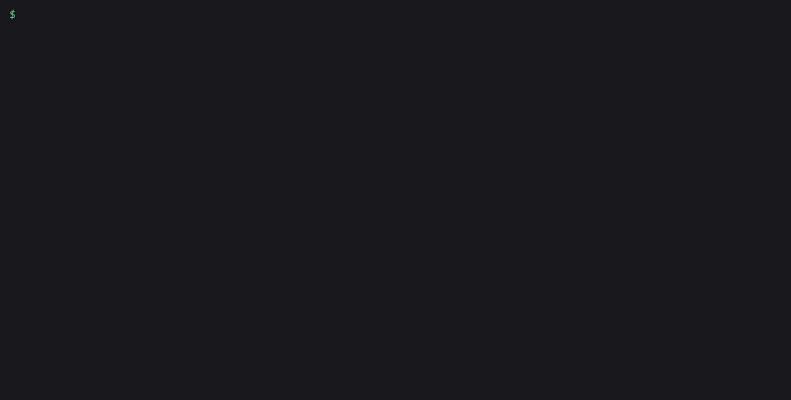

# amagi-inference-calc

Find out which GPU a small office needs to run a local LLM, how fast it will answer each person, and what that speed costs on the used market. It works out memory from the model's real layout and speed from memory bandwidth, using constants fitted on real llama.cpp runs. It comes as a command line tool and a web page.



## Install

```bash
pipx install amagi-inference-calc
```

Python 3.9 or newer. No dependencies.

## Usage

### One model, one card, a few people

```
$ amagi-inference-calc estimate qwen3-14b --gpu rtx-3090 --users 2 --context 8192 --prompt 2000
Qwen3 14B (Q4_K_M) on GeForce RTX 3090 24GB
  load       2 user(s) at once, 8,192-token context each
  memory     11.4 GiB needed of 24.0 GiB -> fits
             weights 8.4 + KV cache 2.5 + runtime 0.5
  speed      77.0 tok/s for one user; 72.3 tok/s each with 2 at once (145 total)
  prompt     2,354 tok/s reading; first token after 0.8 s (2,000-token prompt), 1.7 s if all 2 send at once
  bandwidth  758 GB/s effective (calibrated on this GPU)
  price      $1,399 (used, 2026-10-25) -> $9.67 per tok/s
```

`--users` is how many people send a request at the same moment, not your head count. Each one gets their own KV cache, so memory grows with it and speed per person drops a little.

### The cheapest setup for an office

```
$ amagi-inference-calc office team-10 --model qwen3-14b
10-person office: 3 user(s) at once, 16,384-token context, ~3,000-token prompts
Cheapest setups giving each user at least 15 tok/s (used prices, 2026-10-25):

model      setup                  memory  tok/s each  total  price  $ per tok/s
qwen3-14b  tesla-p40 *       16.4/24 GiB        26.5     80   $345        $4.34
qwen3-14b  2x rtx-3060-12gb  16.9/24 GiB        27.4     82   $660        $8.02
qwen3-14b  2x rtx-3080       16.9/20 GiB        54.4    163   $778        $4.77

Speeds are estimates from a model calibrated on one RTX 3090 (see `calibrate`).
* this card has a caveat: run `estimate` on it to read the note.
NVIDIA only; add --all-vendors to include AMD, Intel and Apple.
```

The presets are `solo`, `team-5`, `team-10`, `team-25`, `doc-review` (long documents, 32K context) and `coding`. Leave out `--model` to compare a set of common models from 8B to 70B. The `*` on the P40 is there because it is a 2016 datacenter card: no tensor cores, slow prompt reading, and it needs its own cooling.

### How far off is it?

```
$ amagi-inference-calc calibrate --role backtest
```

That prints every held-out run next to what the model predicted. On the calibration card, single-user speed came within about 8% on models the fit never saw, and multi-user speed for MoE models within about 10%. Prompt reading for MoE models is rougher (errors from -28% to +64%), so treat first-token times for those as a ballpark. Every other card is scaled from the 3090 by bandwidth, so expect wider errors on those. The full table and every formula are in [docs/CALCULATIONS.md](docs/CALCULATIONS.md).

### Use your own card's numbers

If you have a benchmark from [amagi-tokbench](https://github.com/amagilabs/amagi-tokbench), fit your card's decode bandwidth from it:

```
$ amagi-inference-calc calibrate --tokbench examples/tokbench-rtx3090-qwen2.5-7b.json
3 single-user run(s) of qwen2.5-7b (Q4_K_M): effective decode bandwidth 764 GB/s
use it with: amagi-inference-calc estimate MODEL --gpu YOUR-GPU --decode-bw 764
```

Or read a [memtest_vulkan](https://github.com/GpuZelenograd/memtest_vulkan) log for the card's raw memory bandwidth:

```
$ amagi-inference-calc bandwidth examples/memtest_vulkan_rtx3090.log
NVIDIA GeForce RTX 3090 (24 GB): 739.3 GB/s median over 29 passes (range 738-742.4)
use it with: amagi-inference-calc estimate MODEL --gpu YOUR-GPU --bw 739.3
```

Both files in `examples/` are from real runs on an RTX 3090.

### More commands

- `gpus` lists every card with VRAM, spec and decode bandwidth, and used price.
- `models` lists the built-in models. `estimate` also takes a `.gguf` file or a Hugging Face `config.json`.
- `gguf FILE` reads a GGUF header: parameters, quant, layers and KV bytes per token.
- `vram` is the original calculator's rule of thumb, ported unchanged.
- `--price rtx-3090=1100` or `--prices FILE.csv` replaces the bundled used prices. They are lowest asking prices from 2026-10-25 and they go stale fast.
- `--json` on any command prints machine-readable output.

## The web page

The same model runs in the browser, with office presets, a cheapest-setups table and the original memory calculator on its own tab. It makes no network requests.

```bash
cd web
npm ci
npm run dev      # or: npm run build, then serve web/dist
```

Try it at [amagilabs.github.io/amagi-inference-calc](https://amagilabs.github.io/amagi-inference-calc/). `.github/workflows/pages.yml` rebuilds that page on every push to `main`.

## Use it from Claude Code

This repo ships a skill at `.claude/skills/amagi-inference-calc/SKILL.md`. Copy that folder into your own `.claude/skills/` and Claude Code can size a box for a team, compare used cards, and explain the numbers.

## Limits

- One calibration card (RTX 3090) and one runtime (llama.cpp CUDA). vLLM, ExLlama, MLX and ROCm will land somewhere else.
- More than 8 people at once is past the measured range.
- Multi-card setups assume llama.cpp's default layer split, where memory adds up and speed does not. Tensor parallel is not modelled.
- Prompt speed is only estimated on the 3090. Pass `--tflops` if you know your card's effective rate.
- "Fits" means the estimate is at or under the card's VRAM. A setup showing 12.0/12 GiB has no headroom for a desktop or a second app on the same card.

## Credit

Based on [llm-inference-calculator](https://github.com/alexziskind1/llm-inference-calculator) by Alex Ziskind (MIT). The memory-only tab and the `vram` command are his formulas, and a test checks the Python port against his TypeScript on 1,152 cases. This fork adds the speed model, used-GPU prices, office presets and the calculation docs, and fixes the tooltip clipping reported upstream. The original README is kept at [web/UPSTREAM_README.md](web/UPSTREAM_README.md).

## If this saved you time

A star helps other people find it.

## More from AmagiLabs

- [amagilabs](https://github.com/amagilabs): other small open source tools from the same lab.
- [amagi-tokbench](https://github.com/amagilabs/amagi-tokbench): measure how fast your local LLM runs, with a shareable results card.
- [amagi-throughput-lab](https://github.com/amagilabs/amagi-throughput-lab): find the llama-server settings that serve the most people from one GPU.
- [amagi-model-shelf](https://github.com/amagilabs/amagi-model-shelf): find model files downloaded twice by different tools and get the disk space back.

## License

MIT, see [LICENSE](LICENSE). Copyright (c) 2025 Alex Ziskind. Copyright (c) 2026 Amagisolutionsgroup, Inc. (AmagiLabs).
